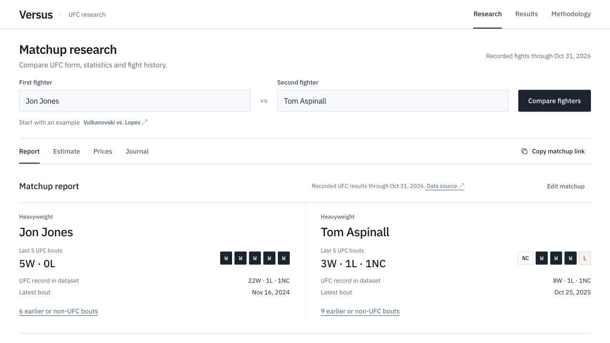

# Versus | UFC Matchup Research

**Live demo: [versus.thomasou.com](https://versus.thomasou.com)**

Compare UFC fighters by recent form, fight statistics, and opponent history.

[](https://versus.thomasou.com/research?fighter1=Jon+Jones&fighter2=Tom+Aspinall&view=report)

## Quick Start

Running locally requires access to the private model and data release in `Smokeybear10/802-DATA.MMA`. The live site works without an account.

```bash
git clone https://github.com/Smokeybear10/005.CORE.versus.git
cd 005.CORE.versus
python3.12 -m venv .venv
source .venv/bin/activate
pip install -r requirements.txt

gh auth login
bash scripts/fetch-data.sh
python backend/app.py
```

Open http://localhost:2102

The fetch script verifies the model and data checksums. `GITHUB_TOKEN` can be used instead of GitHub CLI authentication.

## What It Does

- **Reports:** recent bouts, striking and grappling statistics, shared opponents, and source links.
- **Estimates:** win probabilities for supported matchups, using the date, division, and bout conditions you enter.
- **Prices:** compare manually entered odds against a probability. A provider feed is optional and requires a server-side `ODDS_API_KEY`.
- **Journal:** keep notes and picks in your browser. Entries stay on that device and can be exported as CSV.
- **Results:** inspect the model's historical replay, calibration, and data coverage.

The [results page](https://versus.thomasou.com/results) includes the evaluation limits. Those outcomes were examined during development, so the replay does not establish performance on unseen fights or an advantage over betting markets.

## Tech Stack

| Layer | Tools |
|-------|-------|
| Frontend | HTML, CSS, JavaScript |
| API | Python 3.12, Flask |
| Model and data | scikit-learn, pandas, NumPy, Parquet |
| Hosting | Vercel |

## Project Structure

```text
api/        # Vercel entrypoint
backend/    # Fighter records, matchup reports, model inference
public/     # Website
scripts/    # Data preparation, model evaluation, runtime download
tests/      # API, data, model, and interface checks
data/       # Downloaded runtime; excluded from Git
docs/       # Original analysis and presentation
notebooks/  # Original course notebooks
```

## Checks

```bash
python -m unittest discover -s tests -p 'test_*.py'
python -m unittest discover -s scripts -p 'test_repair_identities.py'
node --test tests/*.mjs tests/*.cjs
```

Some research tests need archived evaluation files beyond the deployed runtime.

Originally built for CIS 5450 at the University of Pennsylvania with Aakash Jha and Kevin Jiang. The original [notebooks](notebooks/) and [analysis](docs/) are retained.

Built by Thomas Ou
